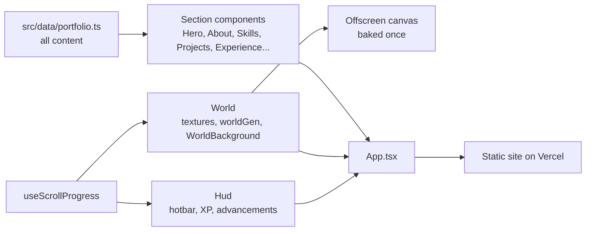

<div align="center">

# Vigneshwaran S — Portfolio

**A portfolio you scroll down through, from sky to The End.**

A block-world themed personal site with a hotbar, weather, mobs, a chat console and generated sound, all drawn in code.

`React 19` · `TypeScript` · `Vite` · `Tailwind CSS` · `Framer Motion` · `Vercel`

[Features](#features) · [Getting started](#getting-started) · [Editing content](#editing-content) · [Architecture](#architecture) · [Structure](#project-structure) · [Performance and accessibility](#performance-and-accessibility) · [Roadmap](#roadmap)

</div>

---

## About

This is the personal portfolio of Vigneshwaran S, covering projects, skills, experience, education, certifications and work in AI and software development. Instead of a flat page, scrolling travels down through a pixel-art world drawn in code (no image assets): sky and surface, caves with ores, deepslate with diamonds, the Nether with lava and a portal, and finally The End for the contact section and footer.

It is an original theme inspired by block-building games. It does not use any game's assets, logo or fonts.

Deployed on Vercel from this repository.

## Features

### The world

- **Layered world** generated at runtime. Textures live in `src/components/World/textures.ts` and are exposed to CSS as `var(--tex-<block>)`.
- **Mobs:** pigs, sheep and chickens wander the surface, and bats flutter in the caves.
- **Night mode:** the sun/moon button in the navbar (or `/theme dark`) darkens the world, lights the torches, adds zombies on the surface and switches the interface to deepslate and blackstone. The choice is remembered for the next visit.
- **Weather:** the navbar button cycles clear, rain, thunderstorm and snow. Thunderstorms strike lightning bolts to the ground, and snow falls across the whole page and settles on the grass and on top of every card and window. `/weather snow` works too.
- **Floating voxel island** in the hero, built from CSS 3D cubes. Drag it to spin.

### Game interface

- **Hotbar** at the bottom: one slot per section. Click a slot or press `1`–`9` to jump.
- **XP bar and level:** the bar fills as you scroll, and the level counts the sections you have visited.
- **Advancement toasts:** "Advancement Made!" appears the first time you reach each section.
- **Block breaking:** clicking anywhere throws pixel particles in the colours of the current layer.
- **Chat console:** press `T` (or `/`, or use the chat button) and type `/help`. Commands include `/tp skills`, `/time set night`, `/weather rain`, `/sound on`, `/whoami`, `/projects`, `/email` and `/github`.
- **Crafting table** under the skills: pick a project and its technologies are placed in a 3×3 grid to craft it. Ingredients come from each project's technologies list.
- Splash text beside the title, an inventory-style skills grid and a title-screen intro.

### Sound

Everything is synthesised with the Web Audio API, with no audio files. Sound is **off by default**; turn it on from the title screen, the speaker button, the `M` key or `/sound on`.

- Footsteps as you scroll and block-breaking sounds that match the layer (grass, dirt, stone, deepslate, netherrack, end stone).
- Pig, sheep, chicken and bat noises, panned to where the mob is on screen.
- A mix that follows the world: rain on the surface (muffled underground), echoes in the caves, a rumble and portal whoosh in the Nether, and wind in The End. Snow adds wind when sound is on.
- Soft generative background music in a different scale for day, night, caves, the Nether and The End (`/music off` to mute).
- Note-block pitches on the hotbar, an XP ding per section, level-up chimes, a chest creak in the crafting table and a teleport warble for `/tp`.
- `/playsound <pig|sheep|chicken|bat|xp|chest|teleport|portal|tnt|thunder|note|…>` plays any of them.

## Tech stack

| Area | Technologies |
| --- | --- |
| Framework and language | React 19, TypeScript |
| Build tooling | Vite, `tsc -b` type-check, oxlint |
| Styling | Tailwind CSS 3, PostCSS, Autoprefixer |
| Animation | Framer Motion, GSAP |
| Icons | lucide-react |
| 3D packages in the manifest | three, @react-three/fiber, @react-three/drei |
| Audio | Web Audio API (browser built-in) |
| Hosting | Vercel |

## Getting started

**Prerequisites:** a recent Node.js and npm.

```bash
git clone https://github.com/Vicky-45-11/vigneshwaran-portfolio.git
cd vigneshwaran-portfolio
npm install
npm run dev
```

| Script | What it does |
| --- | --- |
| `npm run dev` | Local dev server |
| `npm run build` | Type-check and production build into `dist/` |
| `npm run preview` | Serve the production build |
| `npm run lint` | Lint with oxlint |

No environment variables are required.

## Editing content

All personal content (headline, skills, projects, experience, education, certifications, contact details) lives in `src/data/portfolio.ts`. Components only read from it.

To add a repository or live link to a project, set `sourceUrl` or `liveUrl` on that project. Until then the card links to the GitHub profile and no "live project" button is shown.

## Architecture



The site is a static front end. There is no backend, database or external API in the project.

## Project structure

```text
src/
  components/
    World/          textures, worldGen, WorldBackground, Hud, BlockBreak, VoxelIsland
    animations/     FadeIn, Magnet, AnimatedText, VaporType (hero name)
    ui/             ContactButton, LiveProjectButton, SectionHeading, TechIcon
    Intro/ Navbar/ Hero/ Marquee/ About/ Focus/ Skills/
    Projects/ Experience/ (MagicTransform) Education/ Certifications/ Contact/ Footer/
  data/portfolio.ts all site content
  hooks/            useReducedMotion, useMousePosition (useFinePointer), useScrollProgress, useMediaQuery
public/             static files, including the resume PDF
```

## Performance and accessibility

- The world is baked once into an offscreen canvas at 16 px per block and scaled up with nearest-neighbour filtering, so each frame is a single image copy plus a few glowing light sources.
- Animation runs at 24 fps and stops while the tab is hidden.
- Visitors who prefer reduced motion get a still world (no drifting clouds, flicker or particles), no block breaking, a non-spinning island and a scrollable technology strip.
- **VaporType** (hero name): the text stays real DOM text, and a canvas behind it draws the vapor. It pauses off screen and is plain text for reduced-motion visitors. It is written for this site, not the React Bits Pro component, and can be swapped for that once the licensed registry is available.
- **MagicTransform** (Experience): each responsibility starts as a plain document, flies into a glowing core and comes out as a coloured result card. The result cards are always in the markup, so screen readers and reduced-motion visitors get the full list. It is also written for this site.

## Roadmap

Proposed, not yet built:

- [ ] Add project screenshots to this README
- [ ] Add repository and live links to each project via `sourceUrl` and `liveUrl`
- [ ] Add a license file
- [ ] Run a full accessibility audit

## License

No license file has been added to this repository yet, so no license is specified. All rights are reserved by default until one is added.

---

<div align="center">

**Scroll down. Break some blocks. See what is waiting in The End.**

</div>
