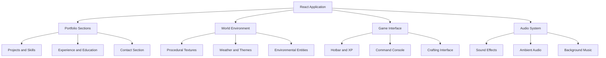

# Vigneshwaran S — Portfolio

<p align="center">
  
  
</p>

<div align="center">

### A portfolio you don't just scroll through — you descend into.

A cinematic, block-world portfolio where software engineering meets pixel-art exploration. Journey from bright skies through underground caves and volcanic dimensions to a mysterious final world, discovering projects, skills, achievements, and contact information along the way.

**React 19 · TypeScript · Vite · Tailwind CSS · Framer Motion · Web Audio API · Vercel**

[Explore Features](#-features) · [Getting Started](#-getting-started) · [Customize Content](#-customize-content) · [Architecture](#-architecture) · [Project Structure](#-project-structure) · [Roadmap](#-roadmap)

</div>

---

## 🌍 About the Project

This is the personal portfolio of **Vigneshwaran S**, a computer science student focused on AI, machine learning, and software development.

Instead of presenting information on a conventional flat webpage, this portfolio transforms professional information into an interactive, game-inspired journey through a procedurally styled voxel world.

Every section represents a different environment. Scrolling becomes exploration, projects become craftable discoveries, skills become inventory items, and the contact section marks the end of the journey.

The world is drawn and animated in code, creating a distinctive visual experience without relying on a collection of pre-rendered world images.

The aesthetic takes inspiration from block-building games while using original implementation and avoiding proprietary game assets, logos, and fonts.

## ✨ Features

### 🗺️ Explore a living pixel world

- **Layered environments:** Travel through the sky and surface, underground caves, deep stone layers, a lava-filled Nether-inspired dimension, and a mysterious End-inspired finale.
- **Procedural textures:** Runtime-generated block textures create the visual identity of the world.
- **Living environments:** Surface animals and cave bats add movement and personality.
- **Interactive floating island:** Rotate a voxel-style island in the hero section.
- **Dynamic atmosphere:** Day and night themes transform the visual environment.

### 🎮 A portfolio with game mechanics

- **Interactive hotbar:** Jump directly between portfolio sections using the bottom navigation.
- **Keyboard navigation:** Use number keys `1–9` to navigate between supported sections.
- **Experience progression:** An XP bar responds to scrolling, while the level indicator tracks section exploration.
- **Advancement notifications:** Discover new sections and receive game-inspired achievement toasts.
- **Block-breaking effects:** Click interactions trigger pixel particles that adapt to the current environment.
- **Inventory-inspired skills:** Explore technical skills through a game-style inventory interface.
- **Project crafting:** Combine project technologies in a crafting-table interface to reveal each project's technology stack.
- **Title-screen introduction:** Enter the portfolio through a themed opening sequence.

### 🌦️ Dynamic weather and world states

- **Weather selection:** Switch between clear skies, rain, thunderstorms, and snow.
- **Lightning effects:** Thunderstorms introduce animated lightning.
- **Snow accumulation:** Snow settles on supported environmental surfaces and interface elements.
- **Persistent themes:** Night mode changes the atmosphere, lighting, and selected environmental details.
- **Command-based controls:** Where supported, weather and theme states can also be changed through the chat console.

### 💬 An interactive command console

Open the in-world chat console and enter commands to interact with the portfolio.

Example commands, subject to the application's implemented command handlers:

```text
/help
/tp skills
/time set night
/weather rain
/sound on
/whoami
/projects
/email
/github
```

The console creates a game-inspired way to navigate the portfolio, access information, and control supported environmental settings.

### 🔊 Procedural audio experience

The sound system uses the **Web Audio API** to generate audio programmatically rather than depending on prerecorded sound files.

- Context-sensitive footsteps and block-breaking effects.
- Environmental animal sounds.
- Spatial panning for supported sound sources.
- Atmospheric audio for caves, rain, lava-inspired environments, and the final dimension.
- Procedurally generated background music that changes with the environment.
- User-controlled sound and music settings.

**Audio is disabled by default.** Users can enable it through the supported interface controls or console commands.

---

## 🛠️ Tech Stack

| Technology | Purpose |
|---|---|
| React 19 | Component-based user interface |
| TypeScript | Type-safe application development |
| Vite | Development server and build tooling |
| Tailwind CSS | Utility-first styling |
| Framer Motion | UI animation and transitions |
| CSS | Voxel-style visuals and environmental effects |
| Web Audio API | Procedural sound generation |
| Vercel | Deployment platform |

The architecture combines a modern React application with custom CSS-based visual environments, animation systems, and browser-generated audio.

## 🚀 Getting Started

### Prerequisites

- Node.js compatible with the project's dependencies.
- npm or the package manager used by the repository.
- Git.

### 1. Clone the repository

```bash
git clone <YOUR_PORTFOLIO_REPOSITORY_URL>
cd <YOUR_PROJECT_DIRECTORY>
```

Replace the placeholders with your actual repository URL and directory name.

### 2. Install dependencies

```bash
npm install
```

If the repository uses another package manager, follow its lockfile and documented installation workflow.

### 3. Start the development server

```bash
npm run dev
```

Open the local URL printed by Vite in your terminal.

### 4. Create a production build

```bash
npm run build
```

### 5. Preview the production build

```bash
npm run preview
```

Check `package.json` to confirm the available scripts before running these commands.

## 🎨 Customize Content

### Personal information

Update the portfolio's existing content source to change your introduction, skills, experience, education, projects, certifications, and contact information.

Inspect the existing data files and component structure before making changes.

### World textures

The procedural texture system is located in:

```text
src/components/World/textures.ts
```

Use the existing texture-generation utilities to customize the appearance of supported block types.

### Theme and weather

Explore the existing theme and weather state management to customize lighting, environmental effects, particles, and supported weather conditions.

### Projects and crafting

Update each project's metadata and technology list in the existing project data source. The crafting interface uses those technologies to represent each project.

### Audio

The procedural sound implementation can be customized to adjust sound effects, environmental ambience, music behavior, and volume controls.

Keep audio opt-in and respect browser autoplay restrictions.

## 🏗️ Architecture

The portfolio is organized around reusable UI components and a collection of interactive environmental systems.



*This diagram represents the intended conceptual organization. Verify the actual imports and source files before treating each item as a separate module.*

## 📁 Project Structure

The main project areas include:

```text
src/
├── components/
│   └── World/
│       └── textures.ts
├── [portfolio components]
├── [application entry points]
└── [styles and supporting modules]
```

The abbreviated structure highlights the known world-texture module. Replace the placeholders with the actual directory tree when documenting the repository.

## ♿ Performance and Accessibility

The project combines animations, particles, procedural audio, and dynamic visual environments. These features should be implemented with care to preserve usability.

- Keep sound disabled until explicitly enabled.
- Respect reduced-motion preferences.
- Ensure interactive controls have accessible names.
- Support keyboard navigation where available.
- Avoid blocking initial rendering with unnecessary effects.
- Clean up event listeners and audio resources.
- Test weather effects and particles on mobile devices.
- Provide readable text and adequate contrast across day and night themes.

Verify each behavior against the current implementation before describing it as complete.

## 🗺️ Roadmap

Potential future improvements include:

- [ ] More interactive voxel environments.
- [ ] Additional keyboard shortcuts and console commands.
- [ ] Expanded achievement and exploration mechanics.
- [ ] Improved mobile controls and performance.
- [ ] More customization options for weather and world themes.
- [ ] Enhanced project previews and interactive demonstrations.
- [ ] A dedicated screenshot gallery and portfolio walkthrough.
- [ ] Additional accessibility and reduced-motion refinements.

These are proposed improvements, not claims about currently implemented functionality.

## 🤝 Contributing

Suggestions, bug reports, and improvements are welcome.

1. Fork the repository.
2. Create a feature branch.
3. Make your changes.
4. Run the project's available checks.
5. Submit a pull request with a clear explanation.

Please follow the repository's license and contribution guidelines where available.

## 📄 License

Check the repository for an existing `LICENSE` file before redistributing or reusing the project.

If no license is present, contact the repository owner for permission before reusing the source code.

## 🌌 The End

This portfolio is an experiment in making personal branding more interactive, playful, and memorable.

It brings together software engineering, creative coding, procedural visuals, and game-inspired interaction to turn a developer portfolio into a world worth exploring.

**Built with code. Inspired by worlds. Designed to be explored.**

<div align="center">

**Vigneshwaran S**

[Portfolio](<YOUR_PORTFOLIO_URL>) · [GitHub](<YOUR_GITHUB_PROFILE_URL>) · [Contact](mailto:<YOUR_EMAIL_ADDRESS>)

</div>
